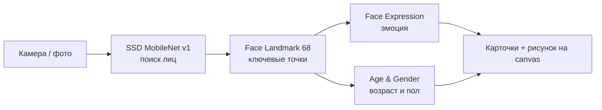

# Face AI

Веб-приложение, которое находит лица на видео с камеры или на фото и определяет эмоцию, примерный возраст и пол. Нейросети работают прямо в браузере: фото и видео никуда не отправляются.


## Возможности

- **Камера**: распознавание в реальном времени, рамка и 68 точек лица поверх видео
- **Фото**: загрузка снимка и анализ всех лиц на нём
- Эмоция (7 классов), возраст и пол для каждого найденного лица
- Модели загружаются один раз и переиспользуются между режимами

## Как это работает



## Карта проекта

```
face-recognition/
├── public/models/            # Веса нейросетей face-api.js
└── src/
    ├── App.jsx               # Переключение режимов, статус загрузки моделей
    ├── hooks/
    │   └── useFaceModels.js  # Однократная загрузка моделей
    ├── lib/
    │   └── faces.js          # Детекция, перевод результатов, отрисовка на canvas
    └── components/
        ├── CameraMode.jsx    # Видео с веб-камеры, анализ каждые 700 мс
        ├── PhotoMode.jsx     # Загрузка и анализ фото
        └── FaceInfo.jsx      # Карточки с результатами
```

## Запуск

```bash
npm install
npm run dev
```

Камера работает только на `localhost` или по HTTPS.
